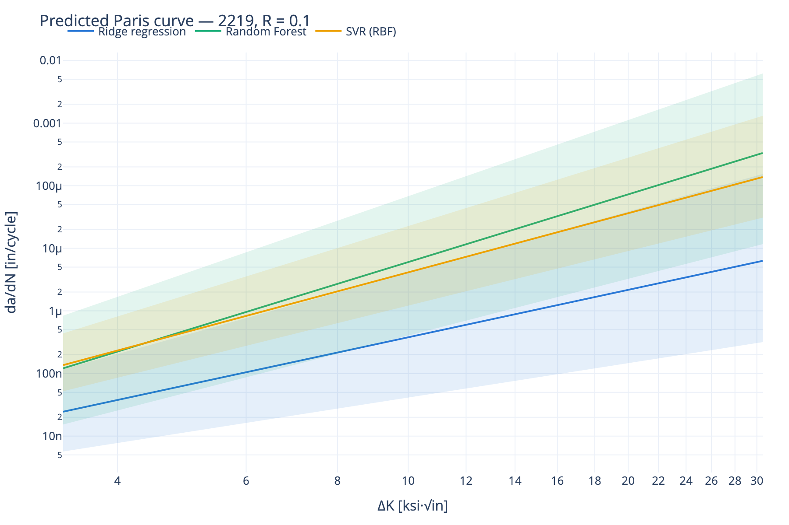
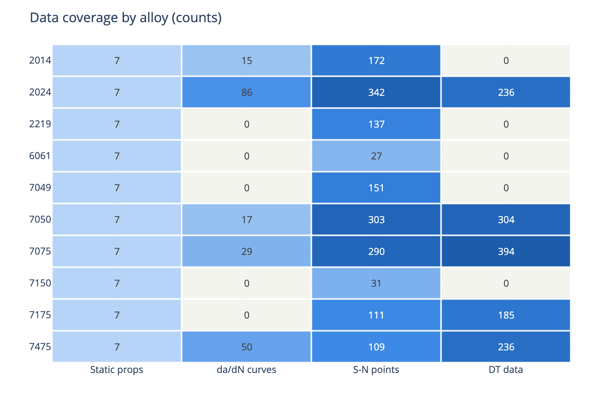
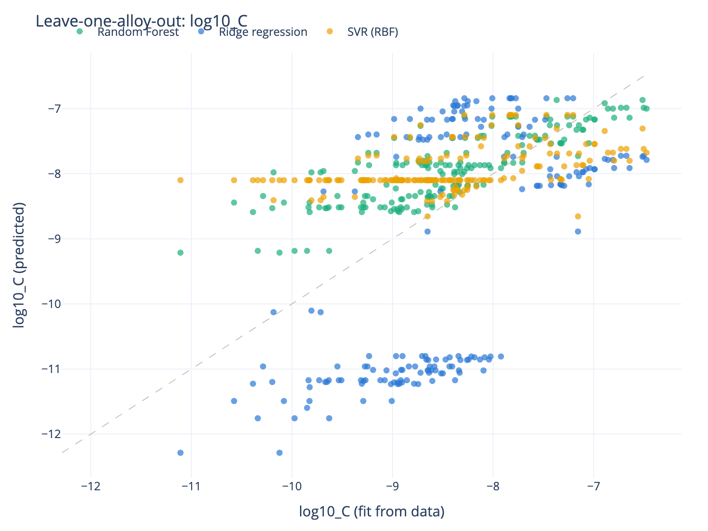

# Aluminum Fatigue ML

🇺🇦 [Українська версія](README.uk.md)

Research prototype of an ML system that predicts missing fatigue characteristics of
aviation aluminum alloys — **Paris law coefficients (C, m) and da/dN–ΔK crack-growth
curves** — from other alloys' experimental data plus the target alloy's known static
properties.

Built per the technical specification in
[`inbox/Техническое_задание_ML_Aluminum_Fatigue_v2.docx`](inbox/): convert a digitized
crack-growth handbook into an AI-Ready dataset, train three baseline models, validate
them honestly (including leave-one-alloy-out), physics-check every result, and produce
tables and figures for a department report and conference.

> **Disclaimer:** predicted curves are a research result, not certification values.
> No airworthiness decisions should be based on them.

## Results at a glance

| | |
|---|---|
| Source data | 49 digitized handbook figures → **2,877 da/dN–ΔK points**, 196 curves, 5 alloys (2014, 2024, 7050, 7075, 7475) |
| Prediction targets | **2219, 6061, 7049, 7150, 7175** — alloys with static properties but no crack-growth curves |
| Models | Ridge regression, Random Forest, SVR (RBF) predicting (log₁₀C, m) |
| Honest validation | Leave-one-alloy-out: Random Forest is the only model with positive skill on an unseen alloy (R² ≈ 0.29 for log₁₀C); random split is far more flattering (R² ≈ 0.78) — the gap is itself a key finding |
| Sanity check | Our per-curve Paris exponents match the handbook's published Walker fit within **1.5%** (p. 72) |
| Data quality | 87 physically impossible digitized points auto-detected and excluded (Kmax bound accounting for R) |

<p align="center">
  
</p>

## Quickstart

Requires [uv](https://docs.astral.sh/uv/) (Python 3.12 is provisioned automatically).

```bash
uv sync                              # install environment
uv run python pipeline.py all       # xlsx → Parquet → fits → models → predictions → report
uv run streamlit run app/dashboard.py   # interactive dashboard
uv run pytest                        # test suite (31 tests, incl. end-to-end)
```

The pipeline is fully regenerable: `data/processed/` and `reports/` are gitignored and
rebuilt from the two source workbooks in `inbox/` by a single command.

## Pipeline

```
inbox/*.xlsx ──convert──▶ Parquet tables ──fit──▶ Paris fits + physics audit
                                             │
targets.yaml ──────────▶ predict ◀──train────┘ (3 models × 3 split schemes)
                            │
                            ▼
              reports/: predictions.xlsx, metrics.csv, figures/*.png,
                        ai_ready_dataset.xlsx, data_quality.txt
```

Individual steps: `uv run python pipeline.py convert | fit | train | predict | export`.

### 1. Convert (`src/afml/convert/`)

The raw workbook (*Fatigue Crack Growth Database for Damage Tolerance Analysis*,
digitized) hides its metadata well:

- **Alloy identity is not in the data sheets** — it lives in chart titles inside the
  OOXML chart XML (`FIGURE B-1. NASGRO EQUATION FOR FIT 2014-T6 SHEET, T-L (M2AD12AB1)`),
  reached through the chartsheet → drawing → chart relationship chain.
- **R-ratio labels use three conventions** (`R - 0.500`, `R -1.000`, `R=-0,330` with
  decimal commas); sign is resolved per sheet, with the figure title's
  "WITH NEGATIVE R VALUES" marker as fallback authority.
- The book's own **NASGRO/Walker fit coefficients** are harvested from chart text boxes
  and used to cross-check our fits.

The AI-Ready workbook contributes static/mechanical/physical properties (677 material
variants, 10 alloys) and S-N points (1,673) for the future Wöhler iteration.

### 2. Validate (`src/afml/schemas.py`)

Pandera schemas at the pipeline boundary: positive ΔK and da/dN, R ∈ [−5, 1), no
duplicate points. A physical filter flags points where **Kmax = ΔK/(1−R) > 200 ksi·√in**
or da/dN > 0.1 in/cycle — this caught 87 corrupted digitized points on handbook
pages 82–90. Everything is reported in `reports/data_quality.txt`, nothing is dropped
silently.

### 3. Fit (`src/afml/models/paris_fit.py`)

Per-curve log-log OLS with iterative trimming of near-threshold / fast-fracture tails.
196 curves fitted, mean r² = 0.995. Fit-level physics audit (exponent bands, r²) marks
curves FAIL/WARN; FAILs are excluded from ML training.

### 4. Train & validate (`src/afml/models/`)

Three baselines (Ridge, Random Forest, SVR) over alloy-level features (Ftu, Fty, Fcy,
Fsu, elongation, density, E, G, ν + R ratio + series/orientation categoricals), under
three split schemes:

| Scheme | Question it answers |
|---|---|
| Random K-fold | How well do we interpolate within known experiments? |
| Group K-fold by dataset | Does knowledge leak between figures digitized from the same experiment? |
| **Leave-one-alloy-out** | Can we predict an alloy the model has never seen? (the spec's core question) |

Uncertainty: Random Forest per-tree quantiles; bootstrap refits for Ridge/SVR
(q05–q95 spread bands, not calibrated confidence intervals).

### 5. Physics audit (`src/afml/physics.py`)

Applied to input curves *and* predictions: da/dN positivity, monotonicity vs ΔK,
Paris exponent plausibility bands for Al alloys, C sanity bound. Output levels
PASS / WARN / FAIL with reasons; predictions currently score 0 FAIL / 2 WARN.

## Dashboard

`uv run streamlit run app/dashboard.py` — four tabs:

1. **Coverage** — alloy × data-kind heatmap, prediction-target list
2. **Curves** — experimental points + per-curve fits, filterable by alloy / R / fit type,
   with the book's published coefficients side by side
3. **Models** — metrics by split scheme, LOAO predicted-vs-actual, predicted target-alloy
   curves with uncertainty bands
4. **Physics audit** — PASS/WARN/FAIL table and the excluded source points

<p align="center">
  
  
</p>

## Project structure

```
inbox/               source xlsx files (read-only, never modified)
src/afml/
  convert/           xlsx → tidy Parquet (chart_meta, crack_growth, ref_fits, ai_ready)
  models/            paris_fit, baselines, splits, uncertainty
  schemas.py         pandera validation + physical plausibility filter
  coverage.py        DuckDB coverage matrix
  features.py        alloy-property feature assembly
  physics.py         physics audit (PASS/WARN/FAIL)
  viz.py, export.py  plotly figures + report deliverables
pipeline.py          CLI orchestrator
app/dashboard.py     Streamlit dashboard
targets.yaml         target alloys + R ratios to predict
tests/               pytest suite (unit + end-to-end against real workbooks)
docs/figures/        figures embedded in this README
```

Stack: Python 3.12 · uv · pandas · Parquet/pyarrow · DuckDB · pandera · scikit-learn ·
Plotly · Streamlit.

> **macOS (Apple Silicon) note:** pyarrow's bundled mimalloc segfaults intermittently in
> threaded use; both entry points switch Arrow to the system allocator at startup.

## Configuration

Edit [`targets.yaml`](targets.yaml) to change which alloys are predicted and at which
R ratios. Physical bounds and audit bands live in `src/afml/schemas.py` and
`src/afml/physics.py`.

## Roadmap

- [ ] S-N (Wöhler) curve prediction from the 1,673-point `fatigue_data` sheet
  (Basquin fits; same models/splits/audit machinery — interfaces are ready)
- [ ] Per-material-variant features (thickness, form) instead of alloy-level medians
- [ ] Report generation (tables + conclusions) for the department report / conference
