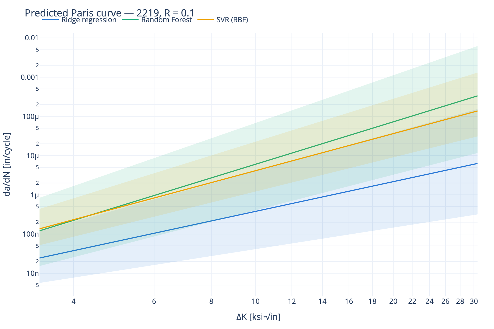
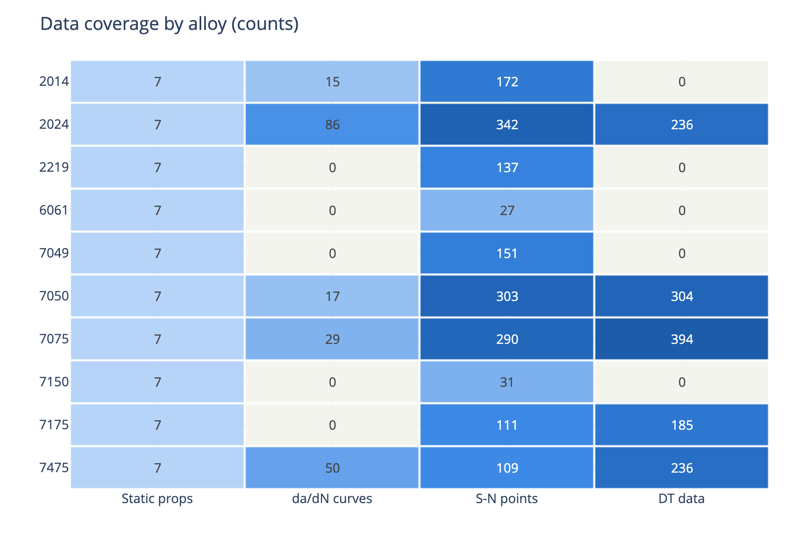
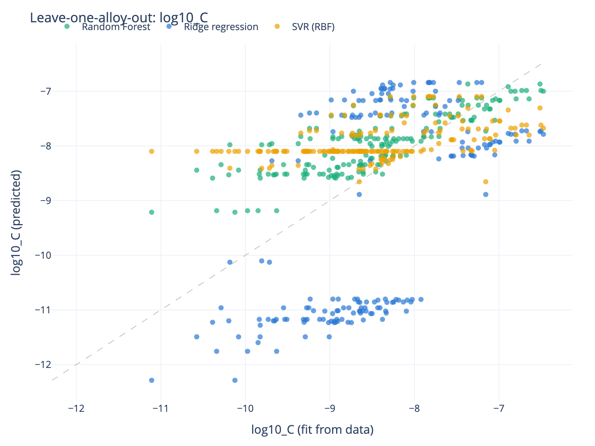

# Aluminum Fatigue ML

🇬🇧 [English version](README.md)

Дослідницький прототип ML-системи, що прогнозує відсутні втомні характеристики
авіаційних алюмінієвих сплавів — **коефіцієнти рівняння Періса (C, m) та криві росту
тріщини da/dN–ΔK** — на основі експериментальних даних інших сплавів і відомих
статичних властивостей цільового матеріалу.

Розроблено за технічним завданням
[`inbox/Техническое_задание_ML_Aluminum_Fatigue_v2.docx`](inbox/): перетворити
оцифрований довідник росту тріщин на AI-Ready датасет, натренувати три базові моделі,
чесно їх провалідувати (включно з leave-one-alloy-out), перевірити кожен результат на
фізичність і підготувати таблиці та рисунки для кафедрального звіту й конференції.

> **Застереження:** прогнозні криві є дослідницьким результатом, а не сертифікаційними
> значеннями. Жодні рішення щодо льотної придатності на них спиратися не можуть.

## Головні результати

| | |
|---|---|
| Вихідні дані | 49 оцифрованих рисунків довідника → **2 877 точок da/dN–ΔK**, 196 кривих, 5 сплавів (2014, 2024, 7050, 7075, 7475) |
| Цільові сплави | **2219, 6061, 7049, 7150, 7175** — мають статичні властивості, але не мають кривих росту тріщини |
| Моделі | Гребенева регресія (Ridge), Random Forest, SVR (RBF); прогнозують (log₁₀C, m) |
| Чесна валідація | Leave-one-alloy-out: лише Random Forest має додатну прогностичну здатність на невідомому сплаві (R² ≈ 0,29 для log₁₀C); random split значно оптимістичніший (R² ≈ 0,78) — сам цей розрив є ключовим висновком |
| Перевірка коректності | Наші показники Періса збігаються з опублікованим у довіднику Walker-фітом у межах **1,5 %** (с. 72) |
| Якість даних | 87 фізично неможливих оцифрованих точок виявлено та вилучено автоматично (обмеження на Kmax з урахуванням R) |

<p align="center">
  
</p>

## Швидкий старт

Потрібен [uv](https://docs.astral.sh/uv/) (Python 3.12 встановлюється автоматично).

```bash
uv sync                              # встановлення середовища
uv run python pipeline.py all       # xlsx → Parquet → фіти → моделі → прогнози → звіт
uv run streamlit run app/dashboard.py   # інтерактивний дашборд
uv run pytest                        # тести (31 тест, включно з наскрізними)
```

Пайплайн повністю відтворюваний: `data/processed/` та `reports/` не зберігаються в git
і перебудовуються однією командою з двох вихідних файлів у `inbox/`.

## Пайплайн

```
inbox/*.xlsx ──convert──▶ Parquet-таблиці ──fit──▶ фіти Періса + фізичний аудит
                                              │
targets.yaml ──────────▶ predict ◀──train─────┘ (3 моделі × 3 схеми розбиття)
                            │
                            ▼
              reports/: predictions.xlsx, metrics.csv, figures/*.png,
                        ai_ready_dataset.xlsx, data_quality.txt
```

Окремі кроки: `uv run python pipeline.py convert | fit | train | predict | export`.

### 1. Конвертація (`src/afml/convert/`)

Вихідний файл (оцифрований довідник *Fatigue Crack Growth Database for Damage
Tolerance Analysis*) добре ховає свої метадані:

- **Назви сплавів відсутні на аркушах із даними** — вони живуть у заголовках графіків
  усередині XML (`FIGURE B-1. NASGRO EQUATION FOR FIT 2014-T6 SHEET, T-L (M2AD12AB1)`)
  і дістаються через ланцюжок зв'язків chartsheet → drawing → chart.
- **Підписи R-відношень мають три різні конвенції** (`R - 0.500`, `R -1.000`, `R=-0,330`
  з комою як десятковим розділювачем); знак визначається для кожного аркуша окремо,
  а позначка "WITH NEGATIVE R VALUES" у назві рисунка є вирішальним аргументом.
- Опубліковані в довіднику **коефіцієнти NASGRO/Walker** зчитуються з текстових полів
  графіків і використовуються для перехресної перевірки наших фітів.

AI-Ready файл додає статичні/механічні/фізичні властивості (677 варіантів матеріалів,
10 сплавів) та точки S-N (1 673) для майбутньої ітерації з кривими Веллера.

### 2. Валідація (`src/afml/schemas.py`)

Схеми pandera на межі пайплайна: додатні ΔK і da/dN, R ∈ [−5, 1), відсутність
дублікатів. Фізичний фільтр позначає точки, де **Kmax = ΔK/(1−R) > 200 ksi·√in** або
da/dN > 0,1 in/cycle — саме він виявив 87 пошкоджених оцифрованих точок на сторінках
82–90 довідника. Усе фіксується у `reports/data_quality.txt`, нічого не викидається
мовчки.

### 3. Фітинг (`src/afml/models/paris_fit.py`)

Лог-лог МНК для кожної кривої з ітеративним відсіканням приграничних ділянок
(поріг / швидке руйнування). Зафітовано 196 кривих, середній r² = 0,995. Аудит фітів
(діапазони показника, r²) присвоює FAIL/WARN; криві з FAIL виключаються з тренування.

### 4. Тренування та валідація (`src/afml/models/`)

Три базові моделі (Ridge, Random Forest, SVR) на ознаках рівня сплаву (Ftu, Fty, Fcy,
Fsu, видовження, густина, E, G, ν + R-відношення + категоріальні серія/орієнтація)
за трьома схемами розбиття:

| Схема | На яке питання відповідає |
|---|---|
| Random K-fold | Наскільки добре ми інтерполюємо в межах відомих експериментів? |
| Group K-fold за dataset | Чи не «протікають» знання між рисунками, оцифрованими з одного експерименту? |
| **Leave-one-alloy-out** | Чи можемо ми прогнозувати сплав, якого модель ніколи не бачила? (головне питання ТЗ) |

Невизначеність: квантилі по деревах для Random Forest; bootstrap-перенавчання для
Ridge/SVR (смуги розкиду q05–q95, не калібровані довірчі інтервали).

### 5. Фізичний аудит (`src/afml/physics.py`)

Застосовується і до вхідних кривих, і до прогнозів: додатність da/dN, монотонність
відносно ΔK, діапазони правдоподібності показника Періса для алюмінієвих сплавів,
обмеження на C. Рівні PASS / WARN / FAIL з поясненнями; поточні прогнози мають
0 FAIL / 2 WARN.

## Дашборд

`uv run streamlit run app/dashboard.py` — чотири вкладки:

1. **Coverage** — теплокарта сплав × тип даних, список цільових сплавів
2. **Curves** — експериментальні точки + фіти кожної кривої з фільтрами за
   сплавом / R / типом фіта, поруч — опубліковані коефіцієнти з довідника
3. **Models** — метрики за схемами розбиття, LOAO «прогноз проти факту», прогнозні
   криві цільових сплавів зі смугами невизначеності
4. **Physics audit** — таблиця PASS/WARN/FAIL та вилучені вихідні точки

<p align="center">
  
  
</p>

## Структура проєкту

```
inbox/               вихідні xlsx (тільки читання, ніколи не змінюються)
src/afml/
  convert/           xlsx → охайні Parquet-таблиці (chart_meta, crack_growth, ref_fits, ai_ready)
  models/            paris_fit, baselines, splits, uncertainty
  schemas.py         валідація pandera + фільтр фізичної правдоподібності
  coverage.py        матриця покриття (DuckDB)
  features.py        збирання ознак із властивостей сплавів
  physics.py         фізичний аудит (PASS/WARN/FAIL)
  viz.py, export.py  графіки plotly + матеріали для звіту
pipeline.py          CLI-оркестратор
app/dashboard.py     дашборд Streamlit
targets.yaml         цільові сплави + R-відношення для прогнозу
tests/               тести pytest (юніт + наскрізні на реальних файлах)
docs/figures/        рисунки, вбудовані в цей README
```

Стек: Python 3.12 · uv · pandas · Parquet/pyarrow · DuckDB · pandera · scikit-learn ·
Plotly · Streamlit.

> **Примітка для macOS (Apple Silicon):** вбудований у pyarrow алокатор mimalloc
> епізодично падає з segfault у багатопотоковому режимі; обидві точки входу одразу
> перемикають Arrow на системний алокатор.

## Налаштування

Редагуйте [`targets.yaml`](targets.yaml), щоб змінити перелік прогнозованих сплавів і
R-відношення. Фізичні межі та діапазони аудиту — у `src/afml/schemas.py` та
`src/afml/physics.py`.

## Плани

- [ ] Прогнозування кривих S-N (Веллера) за 1 673 точками аркуша `fatigue_data`
  (фіти Баскіна; та сама інфраструктура моделей/розбиттів/аудиту — інтерфейси готові)
- [ ] Ознаки рівня варіанта матеріалу (товщина, форма) замість медіан рівня сплаву
- [ ] Генерація звіту (таблиці + висновки) для кафедрального звіту / конференції
